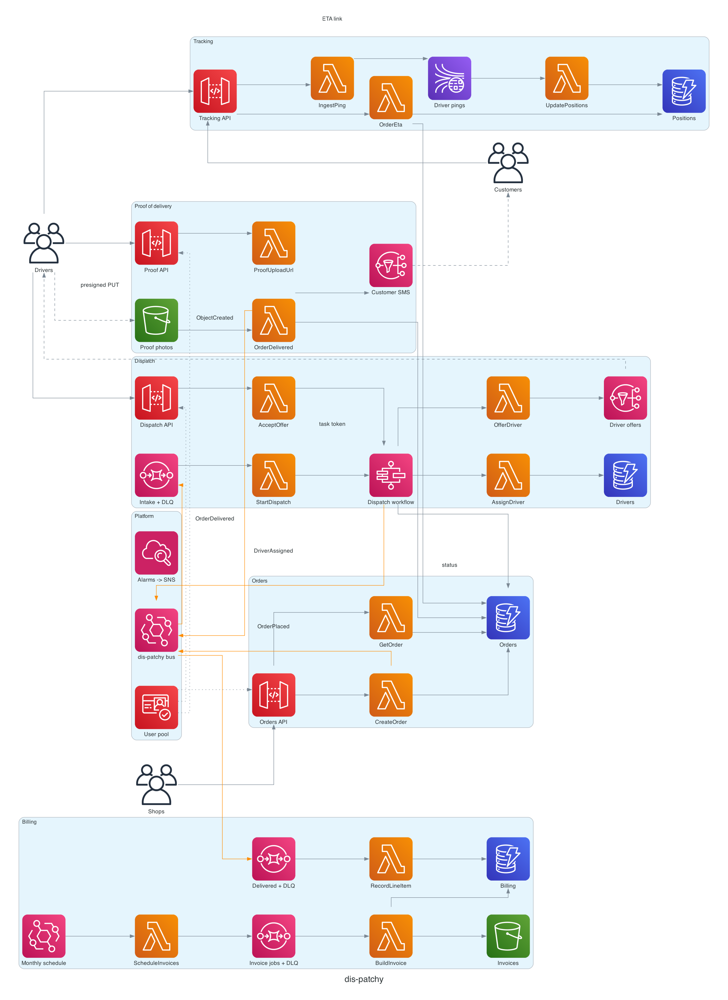

# dis-patchy

A last-mile delivery dispatch platform on AWS, written entirely in Go: AWS CDK for the infrastructure, Go Lambdas for the services.

Shops place delivery orders. The platform assigns a driver, tracks the driver live, collects a proof-of-delivery photo, emails the customer and invoices each shop monthly.

## Purpose

dis-patchy is a **review target**. It exists so code-review tools, linters and AI reviewers have a realistic, multi-service codebase to find problems in. It looks and builds like a real product, and it contains deliberately planted defects. As the name suggests, it is a little patchy.

The planted defects are bugs and gaps in event handling, reliability and correctness. They are **not security holes**:

- Every API method requires a Cognito token and checks ownership.
- No bucket is public.
- No secret appears in code or templates.
- IAM uses scoped grants.

That makes it safe to deploy into a sandbox account. It is still not production software.

## Architecture



One CDK stack per business area. The stacks talk through a shared EventBridge bus, not through each other's resources.

| Stack | What it does | Main services |
|---|---|---|
| `DisPatchy-Platform` | Identity, the event bus, the ops alarm topic | Cognito, EventBridge, SNS |
| `DisPatchy-Orders` | Shops create and read their orders; publishes `OrderPlaced` | API Gateway, Lambda, DynamoDB, SSM |
| `DisPatchy-Dispatch` | Claims a driver, offers the job, waits for acceptance | SQS, Step Functions (task token), SNS, DynamoDB |
| `DisPatchy-Tracking` | Ingests driver location pings and serves ETAs to shops | Kinesis, Lambda, DynamoDB (TTL) |
| `DisPatchy-Proof` | The assigned driver uploads a photo; the upload closes the order | S3 presigned URLs and event notifications |
| `DisPatchy-Notifications` | Emails the customer when a driver is assigned and when the order is delivered | EventBridge, SQS, SES |
| `DisPatchy-Billing` | One line item per delivery, then a monthly CSV invoice per shop | EventBridge schedule, SQS, DynamoDB, S3 |

An order moves through the system like this:

1. A shop calls `POST /orders`, optionally with an `Idempotency-Key` header so retries return the original order. The order is geocoded, stored and announced as `OrderPlaced`.
2. Dispatch picks up the event from its intake queue and starts one workflow execution per order.
3. The workflow claims an available driver and pushes the offer. It then waits until the driver calls `POST /offers/accept`, marks the order `ASSIGNED` and publishes `DriverAssigned`. Notifications emails the customer.
4. While driving, the driver app posts location pings to `POST /pings`. The shop polls `GET /orders/{id}/eta` to show progress on its own site.
5. At the door, the driver requests a presigned URL and uploads the photo. The upload marks the order `DELIVERED` and publishes `OrderDelivered`. Notifications emails the customer again.
6. Billing records a line item per delivered order. At 02:00 UTC on the 1st of each month it builds every shop's invoice.

### Layout

```
main.go                 CDK composition root: wires the stacks, no resources
infra/                  one file per stack, plus shared L3 constructs
services/<context>/     Go Lambda handlers, one directory per function
services/shared/        API Gateway response and claims helpers
docs/architecture.py    diagram source (renders docs/architecture.png)
```

## Deploying

### Prerequisites

- Go 1.27+
- Node.js 20+ (the CDK CLI runs on Node, and `npx` fetches it)
- AWS credentials for a **sandbox** account
- Docker is optional. Lambdas are bundled with your local Go toolchain when it is present.

### Steps

```sh
# 1. Check it builds, tests and synthesises
go build ./... && go vet ./... && go test ./...
npx aws-cdk@2 synth

# 2. Create the geocoder key (SecureString can't be created by CloudFormation)
aws ssm put-parameter --name /dis-patchy/geocoder-api-key --type SecureString --value "<your key>"

# 3. Bootstrap the account/region once
npx aws-cdk@2 bootstrap

# 4. Review, then deploy all seven stacks (~10 minutes)
npx aws-cdk@2 diff -c senderEmail=you@example.com
npx aws-cdk@2 deploy --all -c senderEmail=you@example.com
```

### After deploying

1. **Verify the sender:** SES emails the `senderEmail` address a verification link. Click it.
2. **Verify recipients:** new accounts are in the SES sandbox, so every customer email address must also be a verified identity. That's fine for testing.
3. **Subscribe to alarms:** add your email to the `DisPatchy-Platform` alarms SNS topic.
4. **Create users:** create users in the Cognito user pool. Shops need the `custom:shop_id` attribute and the `shops` group. Drivers need the `drivers` group.
5. **Seed drivers:** add driver records to the `Drivers` table with `pk = DRIVER#<cognito sub>`, `sk = PROFILE`, `gsi1pk = STATUS#AVAILABLE` and `gsi1sk = <cognito sub>`. Driver onboarding is out of scope.

`CreateOrder` calls a placeholder geocoder URL. Until you point it at a real geocoder, order creation returns `422`.

### Tearing down

```sh
npx aws-cdk@2 destroy --all -c senderEmail=you@example.com
aws ssm delete-parameter --name /dis-patchy/geocoder-api-key
```

The stateful resources are retained on purpose: the Cognito pool, the Orders, Drivers and Positions tables, and both photo and invoice buckets. Delete them by hand in the console once you're sure.

## What it costs to run

These are **rough monthly estimates in `us-east-1`**, at on-demand list prices, ignoring the free tier. Prices change, so check the [AWS Pricing Calculator](https://calculator.aws/) before relying on them.

### Idle: deployed with no traffic, about $13/month

Almost everything is pay-per-request, so an idle deployment costs very little. The exception is the Kinesis stream: a provisioned shard bills hourly whether or not anything is sent.

| Item | Cost |
|---|---|
| Kinesis, 1 provisioned shard | ~$11.00 |
| CloudWatch alarms (18 × $0.10) | ~$1.80 |
| DynamoDB, S3, logs and the EventBridge archive at near-zero storage | <$1.00 |
| API Gateway, Lambda, Step Functions, SQS, SES, SSM | $0 (no requests) |

### Busy: about $65–75/month

This assumes 1,000 deliveries a day (≈30k a month). Each delivery has ~30 minutes of driving with a ping every 10 seconds, which comes to ≈5.4M pings a month.

| Item | Cost |
|---|---|
| API Gateway REST (~6.2M requests; pings dominate) | ~$22 |
| X-Ray tracing (active on every function) | ~$10–15 |
| Kinesis (shard plus PUT units) | ~$11 |
| Step Functions Standard (~8 transitions per order) | ~$6 |
| SES (two emails per delivery, ≈60k) | ~$6 |
| DynamoDB on-demand (mostly position writes) | ~$4 |
| CloudWatch Logs ingestion | ~$3 |
| Lambda (arm64, 256 MB) | ~$2.50 |
| Alarms, EventBridge, SQS, S3 | ~$2 |
| **Total** | **~$65–75** |

Cost is driven by ping volume: a shorter ping interval scales API Gateway, Lambda and DynamoDB linearly. If cost matters, the first levers are HTTP API in place of REST API, and batching pings on the device.

## Regenerating the diagram

The diagram needs [Graphviz](https://graphviz.org/) (`brew install graphviz`).

```sh
uv run --with diagrams python docs/architecture.py
```
