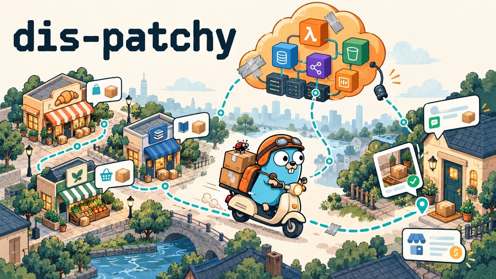
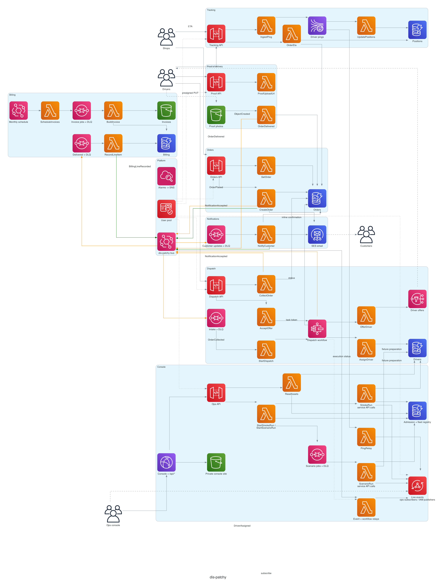
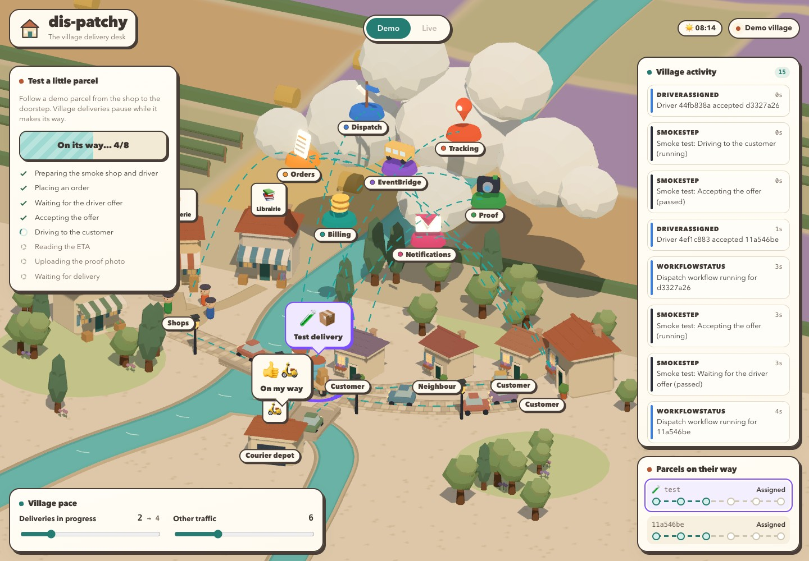
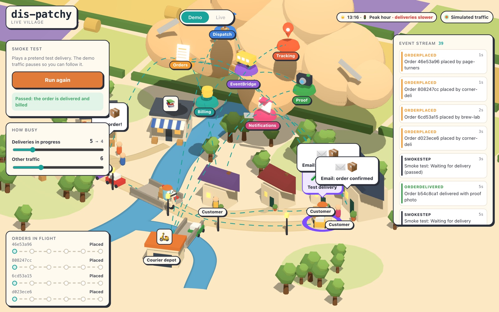

A last-mile delivery dispatch platform on AWS, written entirely in Go: AWS CDK for the infrastructure, Go Lambdas for the services.

Shops place delivery orders. The platform assigns a driver, tracks the driver live, collects a proof-of-delivery photo, emails the customer and invoices each shop monthly.

## Purpose

dis-patchy is a **review target**. It exists so code-review tools, linters and AI reviewers have a realistic, multi-service codebase to find problems in. It looks and builds like a real product, and it contains deliberately planted defects. As the name suggests, it is a little patchy.

The planted defects are bugs and gaps in event handling, reliability and correctness. They are **not security holes**:

- Every API method requires a Cognito token and checks ownership.
- No bucket is public. The live console's page is served through CloudFront from a private bucket, and holds no data until an `ops` user signs in.
- No secret appears in code or templates.
- IAM uses scoped grants.

That makes it safe to deploy into a sandbox account. It is still not production software.

The list of planted defects is kept separately, so reviewers can't peek.

## Architecture



One CDK stack per business area. The stacks talk through a shared EventBridge bus, not through each other's resources.

| Stack | What it does | Main services |
|---|---|---|
| `DisPatchy-Platform` | Identity, the event bus, the ops alarm topic | Cognito, EventBridge, SNS |
| `DisPatchy-Orders` | Shops create and read their orders; sends the order confirmation; publishes `OrderPlaced` | API Gateway, Lambda, DynamoDB, SSM, SES |
| `DisPatchy-Dispatch` | Claims a driver, offers the job, waits for acceptance, records parcel collection | SQS, Step Functions (task token), SNS, DynamoDB |
| `DisPatchy-Tracking` | Ingests driver location pings and serves ETAs to shops | Kinesis, Lambda, DynamoDB (TTL) |
| `DisPatchy-Proof` | The assigned driver uploads a photo; the upload closes the order | S3 presigned URLs and event notifications |
| `DisPatchy-Notifications` | Emails the customer when a driver is assigned and when the order is delivered | EventBridge, SQS, SES |
| `DisPatchy-Billing` | One line item per delivery, then a monthly CSV invoice per shop | EventBridge schedule, SQS, DynamoDB, S3 |
| `DisPatchy-Console` | A live village, test fleet profiles, smoke tests and queued sandbox scenarios | CloudFront, S3, AppSync Events, EventBridge, Lambda, SQS, DynamoDB |

An order moves through the system like this:

1. A shop calls `POST /orders`, optionally with an `Idempotency-Key` header so retries return the original order. The order is geocoded, stored and announced as `OrderPlaced`, and the customer gets a confirmation email.
2. Dispatch picks up the event from its intake queue and starts one workflow execution per order.
3. The workflow claims an available driver and pushes the offer. It then waits until the driver calls `POST /offers/accept`, marks the order `ASSIGNED` and publishes `DriverAssigned`. Notifications emails the customer.
4. The assigned driver records parcel collection with `POST /orders/{id}/collect` on the Dispatch API. The timestamp is preserved on retries and announced as `OrderCollected`; the order remains `ASSIGNED` for compatibility with tracking and proof. While driving, the driver app posts location pings to `POST /pings`. The shop polls `GET /orders/{id}/eta` to show progress on its own site.
5. At the door, the driver requests a presigned URL and uploads the photo. The upload marks the order `DELIVERED` and publishes `OrderDelivered`. Notifications emails the customer again.
6. Billing records a line item per delivered order. At 02:00 UTC on the 1st of each month it builds every shop's invoice.

Successful email submissions publish `NotificationAccepted` with the SES message ID.
This confirms provider acceptance, not arrival in the customer's inbox. Billing publishes
`BillingLineRecorded` only after its transaction commits. These outcome events describe
completed work independently of the events that requested it.

### Layout

```
main.go                 CDK composition root: wires the stacks, no resources
infra/                  one file per stack, plus shared L3 constructs
services/<context>/     Go Lambda handlers, one directory per function
services/shared/        API Gateway response and claims helpers
web/console/            the live console (Vite, React, three.js)
docs/architecture.py    diagram source (renders docs/architecture.png)
```

## Deploying

### Prerequisites

- Go 1.27+
- Node.js 20+ (the CDK CLI runs on Node, and `npx` fetches it)
- AWS credentials for a **sandbox** account
- Docker is optional. Lambdas are bundled with your local Go toolchain when it is present.

### Steps

```sh
# 0. Lint and test touched packages on every commit (needs golangci-lint and shellcheck)
git config core.hooksPath .githooks

# 1. Check it builds, tests and synthesises
go build ./... && go vet ./... && go test ./...
npx aws-cdk@2 synth
npx aws-cdk@2 synth -c nag=true   # optional: cdk-nag AwsSolutions checks, reports in cdk.out/

# 2. Create the geocoder key (SecureString can't be created by CloudFormation)
aws ssm put-parameter --name /dis-patchy/geocoder-api-key --type SecureString --value "<your key>"

# 3. Bootstrap the account/region once
npx aws-cdk@2 bootstrap

# 4. Review, then deploy all eight stacks (~12 minutes)
npx aws-cdk@2 diff -c senderEmail=you@example.com
npx aws-cdk@2 deploy --all -c senderEmail=you@example.com
```

### After deploying

1. **Verify the sender:** SES emails the `senderEmail` address a verification link. Click it.
2. **Verify recipients:** new accounts are in the SES sandbox, so every customer email address must also be a verified identity. That's fine for testing.
3. **Subscribe to alarms:** add your email to the `DisPatchy-Platform` alarms SNS topic.
4. **Create users:** create users in the Cognito user pool. Shops need the `custom:shop_id` attribute and the `shops` group. Drivers need the `drivers` group.
5. **Seed drivers:** add driver records to the `Drivers` table with `pk = DRIVER#<cognito sub>`, `sk = PROFILE`, `gsi1pk = STATUS#AVAILABLE` and `gsi1sk = <cognito sub>`. Driver onboarding is out of scope.

`CreateOrder` calls a placeholder geocoder URL. Until you point it at a real geocoder, order creation returns `422`.

### Testing the deployed app

One command walks an order from placement to delivery and checks every response along the way:

```sh
CUSTOMER_EMAIL=you@example.com scripts/smoke-test.sh
```

It takes about a minute and needs `aws`, `jq`, `curl` and [uv](https://docs.astral.sh/uv/).

- `CUSTOMER_EMAIL` must be SES-verified. It should get three emails: the confirmation, the driver assignment and the delivery. The script can't check those, so look in the inbox.
- The script creates its own test shop and driver (`smoke-shop@dispatchy.test` and `smoke-driver@dispatchy.test`), so you can skip steps 4 and 5 above. Each run sets a fresh random password and marks the driver available again.
- On failure it prints the step and the API's error. Order creation returns `422` until the geocoder is real.

To make the calls by hand, follow the script: each step is a plain `curl`.

### Watching it live

The `DisPatchy-Console` stack serves a warm, low-poly French Riviera village: terracotta roofs, blue shutters, cobbled lanes, turquoise water and vineyards. Shops send parcels up to the white AWS cloud, service icons hop as events land, and Go gopher couriers ride to the customer's door. It runs a demo with simulated orders until you sign in. Time and weather dials let you change the scene; the traffic readout counts cars in view, including queues and town traffic. Phones and tablets fit the village around compact controls, with a side HUD on short landscape screens. [docs/console-visuals.md](docs/console-visuals.md) describes the assets, effects and layouts.



1. Open the `ConsoleUrl` output of `DisPatchy-Console`.
2. Add your Cognito user to the `ops` group. Only `ops` users can watch live events or start a smoke run, because the live channel carries every shop's orders.
3. Switch to **Live** and sign in.
4. Press **Send test parcel**. The same steps as `scripts/smoke-test.sh` run server-side, and each step ticks off on the page as the order moves through the village. The emails go to the `senderEmail` address. One run happens at a time.



How events reach the page: a rule on the bus, a rule for the dispatch workflow's status changes and a second consumer on the ping stream feed small relay Lambdas. Those publish to an AppSync Events channel. Browsers subscribe with a Cognito token, and the channel rejects anyone outside `ops`. The page never calls the service APIs itself. The smoke button calls `POST /api/smoke-runs`, which CloudFront forwards to a Cognito-guarded API.

The server-side smoke run also records parcel collection. A passing smoke run confirms
delivery; email acceptance and the billing line item are shown separately. Delivered
orders remain marked **billing pending** until `BillingLineRecorded` arrives.

The **Sign In** button opens Live sign-in; once authenticated it reads **Live**.
Phone layouts hide shop names, the Neighbour label and the courier-depot label,
while retaining shop icons and operational speech bubbles.

To work on the page locally, run `npm install && npm run dev` in `web/console`. Without a deployment it runs in demo mode.

### Sandbox scenarios and fleet assets

In Live mode, the test panel offers these scenarios:

| Scenario | What the runner does |
|---|---|
| Rush hour | Places orders from three test shops for two couriers, attempts deliveries and reports actual order, workflow and driver states. |
| Ignored offer | Leaves a job offer unanswered for 30 seconds, then reads its state. |
| Concurrent retries | Sends two simultaneous create-order requests with the same idempotency key and reports the distinct returned order IDs. |
| Bad location message | Sends malformed JSON through the tracking API and reads the resulting ETA. |
| Old location arrives late | Sends a recent position followed by one recorded ten minutes earlier, then reads the ETA and its timestamp. |
| Courier goes quiet | Sends three pings, stops for 30 seconds and reports the remaining order state. |
| Repeated delivery proof | Reuses one presigned URL to upload the proof twice and observes delivery events. |

These runs create real sandbox orders and can send email to the configured verified
address. Completing a scenario means its observations were collected; it is not a
passing verdict for the platform. Provider errors appear in the step details.
The geocoder prerequisite still applies to every scenario.

`POST /api/scenario-runs` accepts `{"scenario":"rush"}` (or the corresponding scenario
ID). It requires a Cognito token and membership in `ops`. The starter takes the same
exclusive admission lock as the smoke test and enqueues a job. A separate Lambda
consumes one job per batch, with a four-minute execution budget, queue redelivery
protection and an alarmed DLQ. Cleanup stops only the known unfinished test executions
created by that run; it does not release drivers.

The catalog in `services/console/catalog.json` defines Boulangerie, Librairie and
Marché pickup locations, the Riverside depot and three named scooters. The village
remains an illustrative map, and its houses are not real customer addresses.
Fixture preparation creates dedicated `village-*` shop/driver accounts and records
vehicle/depot associations in the existing Drivers table. It explicitly resets
the selected test profiles and parks leftover idle test drivers. Normal dispatch
availability behaviour is unchanged.

`GET /api/assets` is ops-only and returns the catalog plus the last prepared test
fleet's actual driver statuses. The Console table stores the fixture registry;
the reader fetches statuses from Drivers. Fleet snapshots also reach the live
channel after preparation and observation. Before the first run the catalog is
available with an empty driver list.

The runners use the sandbox's existing dispatcher. If an offer goes to a driver
outside the current test fleet, the run refuses to accept it. Failed create-order
requests may leave work whose ID was never returned; the runner can only clean up
executions it knows about.

### Tearing down

```sh
npx aws-cdk@2 destroy --all -c senderEmail=you@example.com
aws ssm delete-parameter --name /dis-patchy/geocoder-api-key
```

The stateful resources are retained on purpose: the Cognito pool, the Orders, Drivers and Positions tables, and both photo and invoice buckets. Delete them by hand in the console once you're sure.

## What it costs to run

These are **rough monthly estimates in `us-east-1`**, at on-demand list prices, ignoring the free tier. Prices change, so check the [AWS Pricing Calculator](https://calculator.aws/) before relying on them.

### Idle: deployed with no traffic, about $13/month

Almost everything is pay-per-request, so an idle deployment costs very little. The exception is the Kinesis stream: a provisioned shard bills hourly whether or not anything is sent.

| Item | Cost |
|---|---|
| Kinesis, 1 provisioned shard | ~$11.00 |
| CloudWatch alarms (23 × $0.10) | ~$2.30 |
| DynamoDB, S3, logs and the EventBridge archive at near-zero storage | <$1.00 |
| API Gateway, Lambda, Step Functions, SQS, SES, SSM, CloudFront, AppSync Events | $0 (no requests) |

### Busy: about $80–90/month

This assumes 1,000 deliveries a day (≈30k a month). Each delivery has ~30 minutes of driving with a ping every 10 seconds, which comes to ≈5.4M pings a month.

| Item | Cost |
|---|---|
| API Gateway REST (~6.2M requests; pings dominate) | ~$22 |
| X-Ray tracing (active on every function) | ~$10–15 |
| Kinesis (shard plus PUT units) | ~$11 |
| Step Functions Standard (~8 transitions per order) | ~$6 |
| SES (three emails per delivery, ≈90k) | ~$9 |
| DynamoDB on-demand (mostly position writes) | ~$4 |
| CloudWatch Logs ingestion | ~$3 |
| Lambda (arm64, 256 MB) | ~$2.50 |
| Alarms, EventBridge, SQS, S3 | ~$2 |
| AppSync Events (every ping is relayed to the console; one viewer connected all month) | ~$6–11 |
| **Total** | **~$80–90** |

Cost is driven by ping volume: a shorter ping interval scales API Gateway, Lambda and DynamoDB linearly. If cost matters, the first levers are HTTP API in place of REST API, and batching pings on the device.

## Regenerating the diagram

The diagram needs [Graphviz](https://graphviz.org/) (`brew install graphviz`).

```sh
uv run --with diagrams python docs/architecture.py
```
