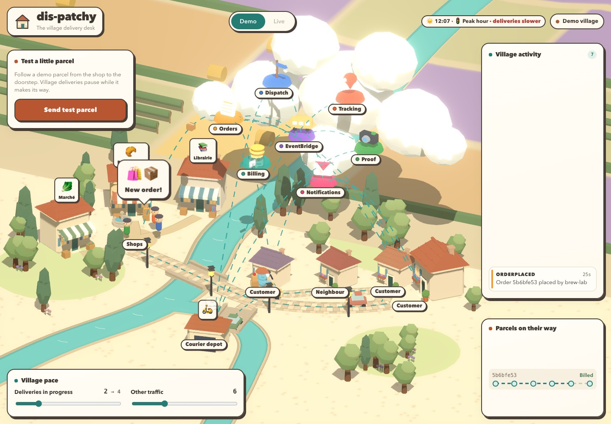
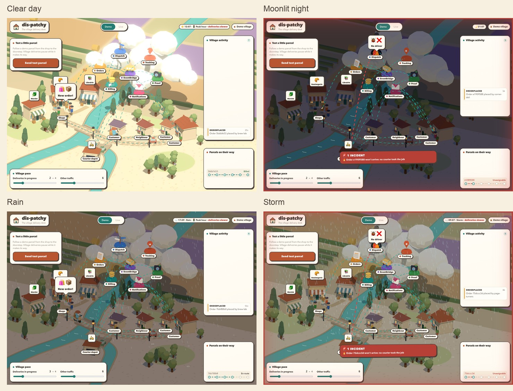
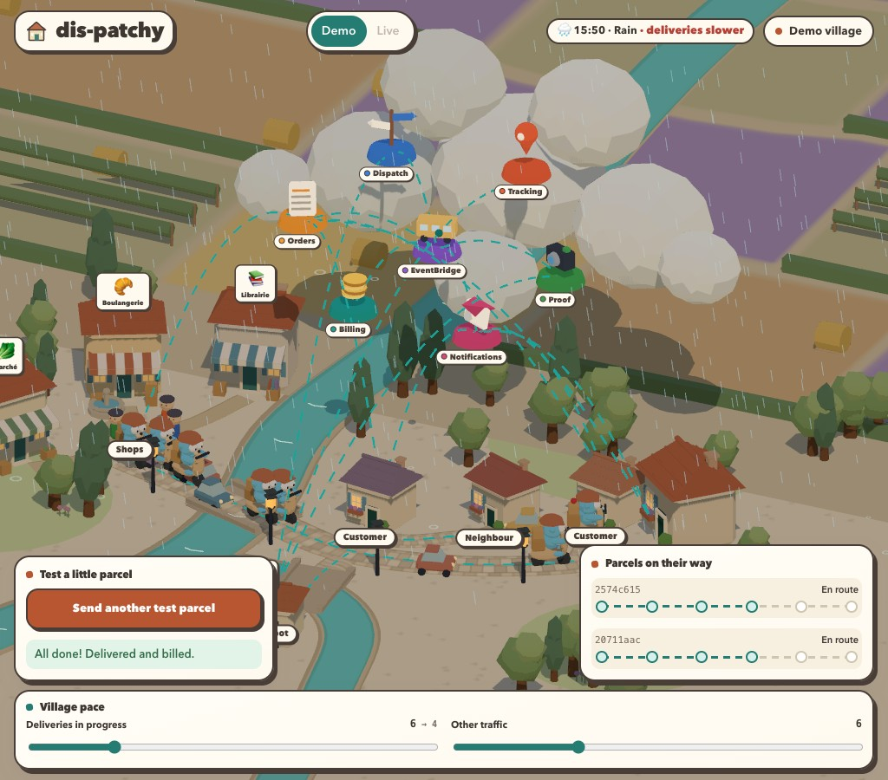
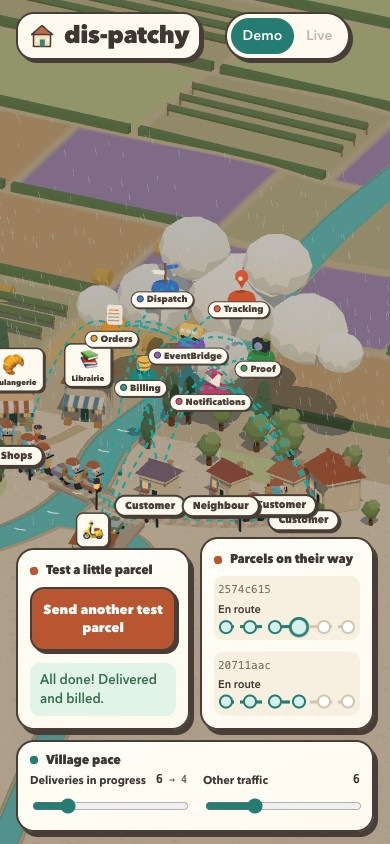

# The live console: look and feel

The `DisPatchy-Console` page draws the platform as a small cartoon French Riviera village with cobbled lanes, terracotta roofs, blue shutters and market shops, ringed by fields and vineyards. Go gophers on scooters do the deliveries. Beret-wearing villagers live in the houses and run the shops. The AWS services float overhead in a small, static white cloud.

This page describes what you see and what each effect means on screen. It's a guide to the visuals, not to the services behind them.

## Visual theme

- **Style:** flat cel shading with an ink outline on every object, in a toon look. Speech bubbles and labels are drawn like comic-strip stickers: cream paper, thick ink border, hard drop shadow.
- **Palette:** warm cream paper (`#f7efdf`), brown ink (`#493e37`), terracotta buttons (`#b95632`) and teal controls (`#247c73`). Routes retain their brighter teal (`#1aa39a`). Each service has its own colour, used for its plinth, label and packets.
- **Camera:** an orthographic three-quarter view, framed to use the foreground. You can orbit and zoom a little; panning is off. The farmland and river continue beyond the default camera.
- **Readability:** service names sit on opaque cream chips with dark ink and coloured markers. Those labels keep their contrast as the scene lighting changes.
- **Accessibility:** reduced motion freezes rain, flames, smoke and route dashes, and suppresses ground splashes, ignition bursts, lightning and the screen-edge pulse. Screen readers hear the incident count, not every ticking timer.

## The village

| Element | What it is |
|---|---|
| Shops | Boulangerie 🥐, Librairie 📚 and Marché 🥬: three shops with striped awnings, roof tiles, shutters and crates of bread, books or produce. Signs sit above the roofs, clear of courier messages. Footpaths meet at the collection square, beside a stone fountain. Shopkeepers hop when an order is placed. |
| Houses | The big cottage at the end of the high street, and Orchard Row: three smaller cottages at odd angles. Hip roofs, chimneys, blue shutters and flower boxes give them a shared village style. Two are customers; the red-roofed one is the neighbour. |
| Residents | A person in each customer house. They step out to collect a delivered parcel, bounce on the doorstep and go back in. They hop in the doorway when an email arrives. |
| Courier depot | Out on its own bank across the river's branch, reached by the depot lane and a small bridge. Job offers land here. |
| Roads | Cobbled high street, Orchard Row and depot lane. Bright dashed route lines run over the paving, so courier health remains visible. |
| River | Turquoise water, pale banks and restrained ripples. Both branches continue beyond the village. Two low-poly stone bridges cross it, widened and lowered to clear the existing vehicles. The bookshop and its footpath sit back from the bank. |
| Fields | Rolling patchwork farmland beyond the camera: vineyards with planted rows and posts, crop strips, lavender, hedges and hay bales follow gentle hills. The village and river valley remain flat. Raised scenery avoids the river banks. |
| Trees and lamps | Round deciduous trees and tall cypresses placed by a fixed seed, so the village is the same on every load. Capped village lanterns glow after dark. |
| Foreground | Subtle grass grain and sparse flower clusters soften the paper ground, clear of the river and roads. |

## The cloud

Each service is a glowing 3D icon on its original coloured pad, with a labelled colour marker. The icons glow faintly in their own colour so night and bad weather never grey them out. The white cloud stays static and has no decorative patches. Pads keep their normal colours, landing hops and dark burning-state colour.

| Service | Icon |
|---|---|
| Orders | A receipt |
| Dispatch | A signpost |
| Tracking | A map pin |
| Proof | A camera |
| Notifications | An envelope |
| Billing | Alternating light gold and amber coins with distinct rims |
| EventBridge | A little yellow bus |

Dashed conduits arc between the services. Packets fly along them: parcels for orders, letters for emails and offers, coins for billing, small dots for courier positions. A pad and its icon hop when a packet lands on them.

## Couriers

Gophers with shaped heads, bodies, ears and paws, oversized eyes, muzzles, two teeth and warm helmets ride rounded scooters loaded with taped parcels.
Pastel cars with faceted cabins, cream bumpers and round headlamps share the lanes.

1. After accepting a job, a courier rides out of the depot, up the depot lane and along the high street to the shops' square.
2. A "🏪📦 Collecting" bubble shows while they pick up.
3. They ride on to the order's house, along the high street or Orchard Row.

Couriers on the same stretch ride side by side. After dark and in storms, each scooter switches on a headlamp with a soft beam along the road.

## Speech bubbles

| Where | Bubble |
|---|---|
| Shops | 🛍️📦 New order! |
| Courier depot | 📨 Job offer, then 👍🛵 On my way |
| Customer house | ✉️📦 Email: order confirmed, ✉️🛵 Email: courier on the way, 📸✅ Delivered |
| Billing | 🏪💲 Line item |

## Time of day and weather

- **Day and night:** demo mode runs a fast day (two minutes, starting at 7am). Dawn and dusk go warm orange; night turns the sky moonlit blue, with glowing windows and lamps. Live mode follows the viewer's local clock.
- **Sunshine:** clear days get a stronger sun and a soft bloom glow.
- **Rain:** fine, varied streaks, small ground splashes and a cool blue cast. The streaks stay translucent so they do not obscure the scene.
- **Storms:** heavier rain, a darker blue-grey sky and brief lightning flashes. Reduced motion disables flashes and splashes.
- **Peak hours:** lunchtime and early evening bring more orders at once.
- **The sky chip:** in the top bar, it shows the time, an icon for the sky you'd see (☀️, 🌙, 🌧️ or ⛈️), "🚦 Peak hour" and, in the demo, "deliveries slower".

In demo mode, rain, storms, peak hours and heavy traffic all stretch deliveries out. Live mode only shows clear skies, because the console has no weather data.

## Compact layouts

Desktop keeps the test panel on the left, activity and parcels on the right, and pace along the bottom.
Phones and tablets at 1100px or below use compact test and parcel cards above a pace strip.
Both sliders remain available. Service and shop labels shrink, while the activity feed hides.
Long failure stages get their own line on phones.

## Village pace: the sliders

The "Village pace" panel sits along the bottom and has two sliders, each up to 20. Hover a slider for what it controls.

- **Deliveries in progress:** how many orders are on their way. In the demo you set how many the shops keep in flight, and the count moves towards it. Live, it's the real number, read-only.
- **Other traffic:** cars driving the high street, Orchard Row and the depot lane, standing for other requests sharing the system. In the demo, more cars mean slower deliveries and more jams. Live, the car count follows the volume of events flowing through.

## When things go wrong

Problems escalate from quiet to loud.

**Quiet oddities** show in amber:

- **Wrong address:** a courier wanders off the road, up the garden path to the neighbour's door, with "🤔📦 Is this the right house?", then rides back. Tracking says "🧭❓ That's not on the map".
- **Delivered twice:** the customer's cottage asks "📦📦❓ Delivered… again?".
- The event stream shows an amber ⚠️ line, and the affected route lines and conduits turn amber.

**Stuck deliveries** show in red:

1. **Jam:** a courier that goes quiet stops where it is. Cars queue nose to tail behind it, honking ("📢🚗🚗 HONK! Stuck in traffic"). Other couriers and cars on the same road stop behind the jam.
2. **Fire:** if it stays stuck, the scooter tips over and burns, with "🔥🛵🔥 Courier down". A brief cartoon ignition puff leads into layered flames, drifting smoke and small embers. Reduced motion suppresses the burst and freezes the ongoing effect.
3. **Lost:** shortly after, the order disappears, and the event stream logs a red "🕳️ LOST" line saying how far it got.

An order that never gets a courier sets the Dispatch pad smouldering, then dark, burning and rattling. Its route lines and the conduit where it stopped turn red.

**Alerts:** while anything is stuck, a red, gently shaking "🚨 INCIDENTS" banner sits above the desktop pace strip or below the compact header, and the edges pulse red. Each line describes the delivery, for example "has stopped on its way to the customer" or "won't arrive: no courier took the job".

## The smoke test

In Live mode, the smoke-test button sends one real order through the deployed system from start to finish. In Demo mode it plays a pretend run. Either way the test order is easy to pick out:

- New demo traffic pauses, so the test delivery has the village to itself.
- Its courier rides inside a pulsing violet ring under a "🧪 Test delivery" flag.
- Its row in Orders in flight is outlined in violet and labelled "🧪 test".
- The step list ticks off as it goes. A passed run folds the list away and shows a green verdict. A failed run keeps the list and adds "💥 The test delivery failed while …" to the alerts.

The panel is labelled "Test a little parcel", with a "Send test parcel" button. "Village activity" is the event stream,
and "Parcels on their way" is the order timeline. Friendly labels retain the same operational behaviour.

## Editing the look

The colour and component reference is [`web/console/styleAesthetic.md`](../web/console/styleAesthetic.md).
Seventeen shared Blender meshes live in a 235KB GLB kit. Their materials still use the
existing cel shader and ink outlines. The editable Blender sheet and rebuild script are
in [`docs/models/`](models/). Building footprints and doorstep positions stay aligned with courier routes.

The kit contains roof, shutters, window frame, door frame, chimney, lantern cap, cypress,
fountain, car body, car cabin, scooter, parcel, cloud puff, soft box, bridge, bread and gopher meshes.
The rebuild script replaces its generated Blender scene while preserving unrelated scenes.
Model tests check names, orientation, roof faces and the triangle/file budgets; vineyard tests check bank clearance.

## Scope and remaining requests

This pass changes appearance and keeps the simulation's event, driver, billing and timing rules.
The following requests are not implemented in this appearance pass:

- Reflect total current traffic in the traffic control.
- Add manual daytime, nighttime and weather controls.
- Change vehicle spawning and road attachment; cars can briefly appear off-road while spawning.
- Remove the coloured service pads after relocating their landing and burning-state cues.

The requested control design is a pair of compact cream dials with brown ink outlines:
teal clock hands, terracotta selection marks, and simple sun/cloud/rain icons. Each dial
would combine its displayed value and input, with keyboard and touch operation. These
interactive controls are not part of the current UI.
